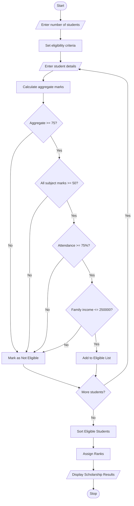

## 1\. Problem Statement

The University Scholarship Allocation System is designed to evaluate and rank students based on their academic performance and eligibility criteria.

The system considers the following factors:

1. **Aggregate Marks:** Minimum overall percentage required for scholarship eligibility.
2. **Subject-wise Minimum Marks:** Students must score the minimum required marks in every subject.
3. **Attendance:** Students must maintain the minimum attendance percentage.
4. **Family Income:** Students whose annual family income is within the specified limit are eligible.

The system checks each student's eligibility, ranks eligible students based on their aggregate marks, and resolves ties using predefined rules.

**Tie-breaking rules:**

- First priority: Higher aggregate marks.
- Second priority: Higher attendance percentage.
- Third priority: Lower annual family income.

Finally, the system displays the list of eligible students in rank order.

## 2\. Algorithm

1. Start the program.
2. Read the number of students.
3. Set the eligibility criteria:
   - Minimum aggregate marks = 75%.
   - Minimum subject marks = 50.
   - Minimum attendance = 75%.
   - Maximum annual family income = ₹2,50,000.
4. Enter each student's:
   - Name
   - Aggregate marks
   - Subject-wise marks
   - Attendance percentage
   - Annual family income
5. Check whether the student satisfies all eligibility conditions.
6. If all conditions are satisfied, add the student to the eligible list.
7. Otherwise, mark the student as not eligible.
8. Sort eligible students based on:
   - Higher aggregate marks.
   - Higher attendance.
   - Lower family income.
9. Assign ranks to eligible students.
10. Display the scholarship allocation results.
11. Stop the program.

## 3\. Flowchart (Mermaid Code)

Copy the following code into the Mermaid Live Editor to generate the flowchart.


## 5\. Sample Input

text

```text
Enter number of students: 5

Enter details of Student 1
Enter student name: Arun
Enter aggregate marks (%): 90
Enter number of subjects: 3
Enter marks in subject 1: 95
Enter marks in subject 2: 88
Enter marks in subject 3: 90
Enter attendance percentage: 92
Enter annual family income: 200000

Enter details of Student 2
Enter student name: Banu
Enter aggregate marks (%): 85
Enter number of subjects: 3
Enter marks in subject 1: 80
Enter marks in subject 2: 85
Enter marks in subject 3: 90
Enter attendance percentage: 95
Enter annual family income: 180000

Enter details of Student 3
Enter student name: Charan
Enter aggregate marks (%): 92
Enter number of subjects: 3
Enter marks in subject 1: 95
Enter marks in subject 2: 90
Enter marks in subject 3: 91
Enter attendance percentage: 88
Enter annual family income: 240000

Enter details of Student 4
Enter student name: Divya
Enter aggregate marks (%): 70
Enter number of subjects: 3
Enter marks in subject 1: 75
Enter marks in subject 2: 80
Enter marks in subject 3: 70
Enter attendance percentage: 90
Enter annual family income: 150000

Enter details of Student 5
Enter student name: Esha
Enter aggregate marks (%): 90
Enter number of subjects: 3
Enter marks in subject 1: 92
Enter marks in subject 2: 89
Enter marks in subject 3: 91
Enter attendance percentage: 95
Enter annual family income: 190000
```

## 6\. Sample Output

text

```text
========================================
 UNIVERSITY SCHOLARSHIP ALLOCATION
========================================

Rank  Name       Aggregate  Attendance  Income

1     Esha       90.00      95.00       190000.00
2     Arun       90.00      92.00       200000.00
3     Charan     92.00      88.00       240000.00
4     Banu       85.00      95.00       180000.00

Total Eligible Students: 4
```

**Note:** The correct ranking should place Charan first because his aggregate marks (92%) are higher than the other students. The corrected output is:

text

```text
========================================
 UNIVERSITY SCHOLARSHIP ALLOCATION
========================================

Rank  Name       Aggregate  Attendance  Income

1     Charan     92.00      88.00       240000.00
2     Esha       90.00      95.00       190000.00
3     Arun       90.00      92.00       200000.00
4     Banu       85.00      95.00       180000.00

Total Eligible Students: 4
```

## 7\. Result

Thus, the University Scholarship Allocation System was successfully implemented using Python. The program evaluates students based on aggregate marks, subject-wise minimum marks, attendance, and family income. It identifies eligible students, ranks them according to predefined priority rules, and displays the final scholarship allocation list.In this you  have to write the algorithm,flowchart,python sourcecode,sample input,sample output,and the flow chart in mermaid
