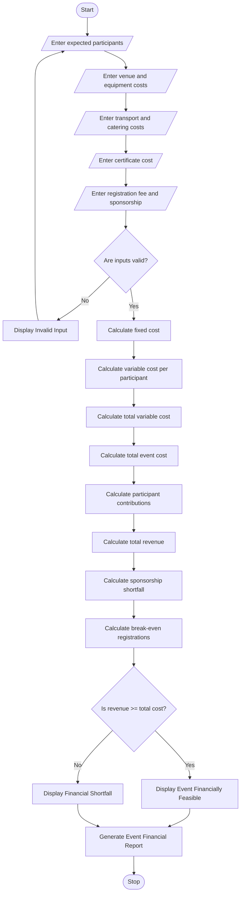

## 1\. Problem Statement

The Campus Event Financial Planning System is designed to calculate and analyze the total expenses and financial requirements involved in organizing a college or university event.

The system calculates various event expenses, including venue charges, equipment costs, catering expenses, transportation costs, and certificate printing costs. It also determines participant contributions, sponsorship shortfalls, and the minimum number of registrations required to achieve the break-even point.

The system considers the following factors:

1. **Venue Cost:** Expenses for booking the event hall or auditorium.
2. **Equipment Cost:** Expenses for microphones, projectors, speakers, lighting, and other equipment.
3. **Catering Cost:** Food expenses based on the number of participants.
4. **Transportation Cost:** Expenses for transportation facilities.
5. **Certificate Cost:** Printing expenses based on the number of participants.
6. **Total Event Cost:** Sum of all event expenses.
7. **Participant Contribution:** Amount collected from each registered participant.
8. **Sponsorship Amount:** Financial support received from sponsors.
9. **Sponsorship Shortfall:** Additional sponsorship required if the available sponsorship is insufficient.
10. **Break-Even Analysis:** Calculates the minimum registrations required to cover the total event expenses.

**Calculation Rules:**

- Total Fixed Cost = Venue Cost + Equipment Cost + Transportation Cost.
- Variable Cost = Catering Cost + Certificate Cost.
- Total Event Cost = Fixed Cost + Variable Cost.
- Total Revenue = Participant Contributions + Sponsorship.
- If total revenue is greater than or equal to total expenses, the event is financially feasible.
- Otherwise, the system calculates the financial shortfall.

Finally, the system generates an event financial report displaying total expenses, participant contributions, sponsorship requirements, and minimum registrations required to break even.

---

## 2\. Algorithm

1. Start the program.
2. Enter the number of expected participants.
3. Enter the venue cost.
4. Enter the equipment cost.
5. Enter the transportation cost.
6. Enter the catering cost per participant.
7. Enter the certificate cost per participant.
8. Enter the registration fee per participant.
9. Enter the available sponsorship amount.
10. Validate all input values.
11. Calculate the total fixed cost.

Fixed Cost = Venue Cost + Equipment Cost + Transportation Cost

12. Calculate the variable cost per participant.

Variable Cost = Catering Cost + Certificate Cost

13. Calculate the total variable cost.

Total Variable Cost = Variable Cost × Number of Participants

14. Calculate the total event cost.

Total Event Cost = Fixed Cost + Total Variable Cost

15. Calculate participant contributions.

Participant Contributions = Number of Participants × Registration Fee

16. Calculate total available revenue.

Total Revenue = Participant Contributions + Sponsorship

17. Calculate sponsorship shortfall.

Sponsorship Shortfall = Total Event Cost − Participant Contributions − Available Sponsorship

18. Calculate the minimum registration count required to break even.

Break-Even Registrations = Fixed Cost − Sponsorship divided by Registration Fee − Variable Cost per Participant.

19. Check whether the available registrations are sufficient.
20. Display the event financial report.
21. Display whether the event meets the break-even condition.
22. Stop the program.

---

## 3\. Flowchart (Mermaid Code)

Copy the following code into the Mermaid Live Editor to generate the flowchart.


## 4\. Sample Input

text

```text
CAMPUS EVENT FINANCIAL PLANNING

Enter expected number of participants: 200

Enter venue cost: Rs. 15000

Enter equipment cost: Rs. 8000

Enter transportation cost: Rs. 5000

Enter catering cost per participant: Rs. 150

Enter certificate cost per participant: Rs. 20

Enter registration fee per participant: Rs. 250

Enter available sponsorship amount: Rs. 10000
```

---

## 5\. Sample Output

text

```text
================================================
       CAMPUS EVENT FINANCIAL REPORT
================================================

EXPECTED PARTICIPANTS: 200

EVENT EXPENSE DETAILS

-----------------------------------------------

Venue Cost: Rs. 15000.0

Equipment Cost: Rs. 8000.0

Transportation Cost: Rs. 5000.0

Catering Cost: Rs. 30000.0

Certificate Cost: Rs. 4000.0

-----------------------------------------------

Total Fixed Cost: Rs. 28000.0

Total Variable Cost: Rs. 34000.0

TOTAL EVENT COST: Rs. 62000.0

REVENUE DETAILS

-----------------------------------------------

Registration Fee per Participant: Rs. 250.0

Participant Contributions: Rs. 50000.0

Available Sponsorship: Rs. 10000.0

Total Available Revenue: Rs. 60000.0

-----------------------------------------------

SPONSORSHIP ANALYSIS

Additional Sponsorship Required: Rs. 2000.0

BREAK-EVEN ANALYSIS

Minimum Registrations Required: 150

Actual Expected Registrations: 200

EVENT FINANCIAL STATUS: Event is Running at a Loss

Financial Deficit: Rs. 2000.0

================================================
```


