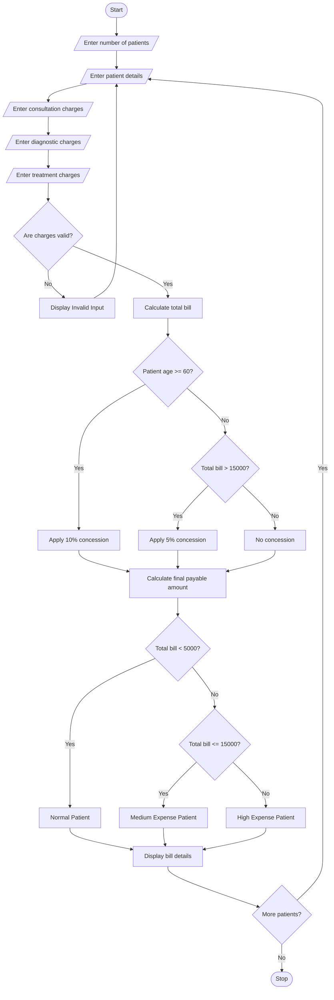

## 1\. Problem Statement

The Hospital Billing and Patient Classification System is designed to calculate the total hospital expenses of patients based on consultation charges, diagnostic charges, and treatment charges.

The system processes patient details and calculates the final bill by considering the following factors:

1. **Consultation Charges:** Fees charged by the doctor for consultation.
2. **Diagnostic Charges:** Charges for laboratory tests, X-rays, scans, and other diagnostic services.
3. **Treatment Charges:** Expenses for medicines, operations, and other medical treatments.
4. **Conditional Concessions:** Discounts are provided based on patient category or total bill amount.
5. **Billing Validation:** The system checks that all charges are non-negative and valid.
6. **Patient Classification:** Patients are classified according to their total bill amount and payment policy.

**Payment Policy:**

- Below ₹5,000 – Normal Patient.
- ₹5,000 to ₹15,000 – Medium Expense Patient.
- Above ₹15,000 – High Expense Patient.

**Concession Policy:**

- Senior citizens receive a 10% concession.
- If the total bill exceeds ₹15,000, a 5% concession is applied.
- Only one concession is applied. If both conditions are satisfied, the higher concession is selected.

Finally, the system displays the patient's details, total bill, concession amount, final payable amount, and patient classification.

## 2\. Algorithm

1. Start the program.
2. Enter the number of patients.
3. Enter the patient's name and age.
4. Enter consultation charges.
5. Enter diagnostic charges.
6. Enter treatment charges.
7. Validate all input values.
8. Calculate the total bill by adding consultation, diagnostic, and treatment charges.
9. Check the concession conditions:
   - If age is 60 or above, apply a 10% concession.
   - If the total bill exceeds ₹15,000, apply a 5% concession.
   - If both conditions are satisfied, apply the higher concession.
10. Calculate the concession amount.
11. Calculate the final payable amount.
12. Classify the patient:

- Below ₹5,000: Normal Patient.
- ₹5,000 to ₹15,000: Medium Expense Patient.
- Above ₹15,000: High Expense Patient.

13. Display the complete billing details.
14. Repeat the process for all patients.
15. Stop the program.

## 3\. Flowchart (Mermaid Code)

Copy this code into the Mermaid Live Editor to generate the flowchart.

[Mermaid Live Editor](<https://mermaid.live/?utm_source=chatgpt.com>


## 4\. Sample Input

text

```text
Enter number of patients: 4

Enter Details of Patient 1
Enter patient name: Arun
Enter patient age: 25
Enter consultation charges: Rs. 500
Enter diagnostic charges: Rs. 1000
Enter treatment charges: Rs. 2000

Enter Details of Patient 2
Enter patient name: Banu
Enter patient age: 65
Enter consultation charges: Rs. 1000
Enter diagnostic charges: Rs. 2000
Enter treatment charges: Rs. 3000

Enter Details of Patient 3
Enter patient name: Charan
Enter patient age: 40
Enter consultation charges: Rs. 2000
Enter diagnostic charges: Rs. 4000
Enter treatment charges: Rs. 12000

Enter Details of Patient 4
Enter patient name: Divya
Enter patient age: 30
Enter consultation charges: Rs. 300
Enter diagnostic charges: Rs. 500
Enter treatment charges: Rs. 1000
```

## 5\. Sample Output

text

```text
==========================================
       HOSPITAL BILLING REPORT
==========================================

Patient Number: 1
Patient Name: Arun
Age: 25
Consultation Charges: Rs. 500.0
Diagnostic Charges: Rs. 1000.0
Treatment Charges: Rs. 2000.0
------------------------------------------
Total Bill: Rs. 3500.0
Concession: Rs. 0.0
Final Payable Amount: Rs. 3500.0
Patient Classification: Normal Patient
------------------------------------------

Patient Number: 2
Patient Name: Banu
Age: 65
Consultation Charges: Rs. 1000.0
Diagnostic Charges: Rs. 2000.0
Treatment Charges: Rs. 3000.0
------------------------------------------
Total Bill: Rs. 6000.0
Concession: Rs. 600.0
Final Payable Amount: Rs. 5400.0
Patient Classification: Medium Expense Patient
------------------------------------------

Patient Number: 3
Patient Name: Charan
Age: 40
Consultation Charges: Rs. 2000.0
Diagnostic Charges: Rs. 4000.0
Treatment Charges: Rs. 12000.0
------------------------------------------
Total Bill: Rs. 18000.0
Concession: Rs. 900.0
Final Payable Amount: Rs. 17100.0
Patient Classification: High Expense Patient
------------------------------------------

Patient Number: 4
Patient Name: Divya
Age: 30
Consultation Charges: Rs. 300.0
Diagnostic Charges: Rs. 500.0
Treatment Charges: Rs. 1000.0
------------------------------------------
Total Bill: Rs. 1800.0
Concession: Rs. 0.0
Final Payable Amount: Rs. 1800.0
Patient Classification: Normal Patient
------------------------------------------

Total Number of Patients: 4

Total Hospital Collection: Rs. 27800.0

==========================================
          THANK YOU
==========================================
```

## 6\. Result

Thus, the Hospital Billing and Patient Classification System was successfully implemented using Python. The program calculates consultation, diagnostic, and treatment charges, applies conditional concessions, validates billing inputs, and classifies patients according to the predefined payment policy. It also generates individual patient bills and calculates the total hospital collection.

**Note:** All charges, concession percentages, and classification limits are assumed values for academic purposes. Actual hospital billing policies may differ.In this you have to write the algorithm,flowchart,python source code,sample input,samplce output,and the flow chart in mermaid
