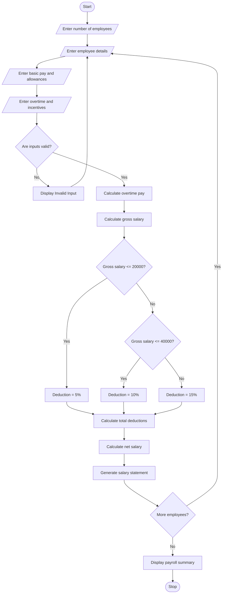

## 1\. Problem Statement

The Employee Payroll and Deduction Analysis System is designed to calculate employees' monthly salaries based on basic pay, allowances, overtime, and incentives.

The system calculates the gross salary and applies progressive deductions to determine the employee's net salary.

The system considers the following factors:

1. **Basic Pay:** The fixed monthly salary of an employee.
2. **Allowances:** Additional payments such as House Rent Allowance (HRA) and Dearness Allowance (DA).
3. **Overtime:** Additional payment for extra working hours.
4. **Incentives:** Extra rewards provided based on employee performance.
5. **Progressive Deductions:** Deductions are calculated based on gross salary:
   - Up to ₹20,000 – 5%.
   - ₹20,001 to ₹40,000 – 10%.
   - Above ₹40,000 – 15%.
6. **Net Salary:** The final salary after subtracting deductions from gross salary.

Finally, the system generates a formatted salary statement displaying employee details, gross salary, deductions, and net salary.

## 2\. Algorithm

1. Start the program.
2. Enter the number of employees.
3. Enter employee name and employee ID.
4. Enter basic pay.
5. Enter House Rent Allowance (HRA).
6. Enter Dearness Allowance (DA).
7. Enter overtime hours and overtime rate.
8. Enter performance incentives.
9. Validate all salary inputs.
10. Calculate overtime pay:

Overtime Pay = Overtime Hours × Overtime Rate

11. Calculate gross salary:

Gross Salary = Basic Pay + HRA + DA + Overtime Pay + Incentives

12. Calculate progressive deductions:

- If gross salary is up to ₹20,000, deduct 5%.
- If gross salary is between ₹20,001 and ₹40,000, deduct 10%.
- If gross salary is above ₹40,000, deduct 15%.

13. Calculate net salary:

Net Salary = Gross Salary − Deductions

14. Display the formatted salary statement.
15. Repeat the process for all employees.
16. Stop the program.

## 3\. Flowchart (Mermaid Code)

Copy the following code into the Mermaid Live Editor to generate the flowchart.

[Mermaid Live Editor](<https://mermaid.live/?utm_source=chatgpt.com>)

## 5\. Sample Input

text

```text
Enter number of employees: 3

Enter Details of Employee 1
Enter Employee ID: 101
Enter Employee Name: Arun
Enter Basic Pay: Rs. 20000
Enter HRA: Rs. 3000
Enter DA: Rs. 2000
Enter Overtime Hours: 10
Enter Overtime Rate per Hour: Rs. 100
Enter Incentives: Rs. 2000

Enter Details of Employee 2
Enter Employee ID: 102
Enter Employee Name: Banu
Enter Basic Pay: Rs. 30000
Enter HRA: Rs. 5000
Enter DA: Rs. 3000
Enter Overtime Hours: 15
Enter Overtime Rate per Hour: Rs. 150
Enter Incentives: Rs. 4000

Enter Details of Employee 3
Enter Employee ID: 103
Enter Employee Name: Charan
Enter Basic Pay: Rs. 40000
Enter HRA: Rs. 8000
Enter DA: Rs. 5000
Enter Overtime Hours: 20
Enter Overtime Rate per Hour: Rs. 200
Enter Incentives: Rs. 5000
```

## 6\. Sample Output

text

```text
==============================================
          EMPLOYEE SALARY STATEMENT
==============================================

Employee ID: 101
Employee Name: Arun

----------------------------------------------
Basic Pay          : Rs. 20000.0
HRA                : Rs. 3000.0
DA                 : Rs. 2000.0
Overtime Pay       : Rs. 1000.0
Incentives         : Rs. 2000.0

----------------------------------------------
Gross Salary       : Rs. 28000.0
Total Deduction    : Rs. 2800.0
Net Salary         : Rs. 25200.0
==============================================

Employee ID: 102
Employee Name: Banu

----------------------------------------------
Basic Pay          : Rs. 30000.0
HRA                : Rs. 5000.0
DA                 : Rs. 3000.0
Overtime Pay       : Rs. 2250.0
Incentives         : Rs. 4000.0

----------------------------------------------
Gross Salary       : Rs. 44250.0
Total Deduction    : Rs. 6637.5
Net Salary         : Rs. 37612.5
==============================================

Employee ID: 103
Employee Name: Charan

----------------------------------------------
Basic Pay          : Rs. 40000.0
HRA                : Rs. 8000.0
DA                 : Rs. 5000.0
Overtime Pay       : Rs. 4000.0
Incentives         : Rs. 5000.0

----------------------------------------------
Gross Salary       : Rs. 62000.0
Total Deduction    : Rs. 9300.0
Net Salary         : Rs. 52700.0
==============================================

             PAYROLL SUMMARY
==============================================

Total Employees       : 3
Total Gross Salary    : Rs. 134250.0
Total Deductions      : Rs. 18737.5
Total Net Salary      : Rs. 115512.5

==============================================
```

## 7\. Result

Thus, the Employee Payroll and Deduction Analysis System was successfully implemented using Python. The program calculates gross salary based on basic pay, allowances, overtime, and incentives. It applies progressive deductions, calculates net salary, validates employee salary inputs, and generates formatted salary statements along with a payroll summary.

**Note:** The deduction percentages and salary limits used in this program are assumed values for academic purposes. They can be modified according to an organization's payroll policy.In this you have to write the algorithm, flowchart,python source code,sample input,sample output,and the flow chart,sample output,and the flow chart in mermaid
