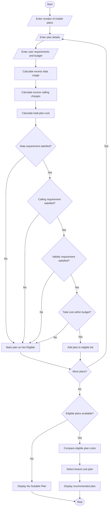

## 1\. Problem Statement

The Multi-Plan Telecommunications Cost Optimization System is designed to compare different mobile recharge plans and identify the most economical plan based on the user's monthly usage, validity requirements, and budget constraints.

The system evaluates multiple mobile plans by considering the following factors:

1. **Plan Cost:** The total price of each mobile plan.
2. **Data Usage:** The amount of internet data provided by the plan.
3. **Call Minutes:** The total calling minutes included in the plan.
4. **Validity:** The number of days the plan remains active.
5. **Excess Charges:** Additional charges applied when data or calling usage exceeds the plan limits.
6. **Budget Constraint:** The plan cost must be within the user's specified budget.
7. **Cost Optimization:** The system compares all eligible plans and identifies the plan with the lowest total cost.

**Plan Selection Policy:**

- The plan must provide sufficient data for the user's requirements.
- The plan must provide sufficient calling minutes.
- The plan validity must meet the required number of days.
- The total cost must not exceed the user's budget.
- If multiple plans satisfy all conditions, the plan with the lowest total cost is selected.

Finally, the system displays all available plans, their additional charges, eligible plans, and the most economical plan.

## 2\. Algorithm

1. Start the program.
2. Enter the number of mobile plans.
3. Enter the details of each plan:
   - Plan name.
   - Plan cost.
   - Data limit in GB.
   - Calling minutes.
   - Validity in days.
   - Extra data charge per GB.
   - Extra calling charge per minute.
4. Enter the user's requirements:
   - Required data in GB.
   - Required calling minutes.
   - Required validity days.
   - Maximum budget.
5. Calculate excess data usage for each plan.
6. Calculate excess calling charges.
7. Calculate the total plan cost.
8. Check whether the plan satisfies the data, calling, validity, and budget requirements.
9. If all conditions are satisfied, add the plan to the eligible list.
10. Compare the total costs of eligible plans.
11. Select the plan with the lowest total cost.
12. Display all plan details and the recommended plan.
13. If no plan satisfies the requirements, display an appropriate message.
14. Stop the program.

## 3\. Flowchart (Mermaid Code)

Copy the following code into the Mermaid Live Editor to generate the flowchart.

[Mermaid Live Editor](<https://mermaid.live/?utm_source=chatgpt.com>)

## 4\. Sample Input

text

```text
Enter number of mobile plans: 4

Enter User Requirements

Required Data (GB): 2
Required Calling Minutes: 500
Required Validity (Days): 28
Maximum Budget (Rs.): 400

Enter Details of Plan 1
Plan Name: Basic
Plan Cost (Rs.): 199
Data Limit (GB): 1.5
Calling Minutes: 300
Validity (Days): 28
Extra Data Charge per GB: Rs. 50
Extra Calling Charge per Minute: Rs. 0.50

Enter Details of Plan 2
Plan Name: Smart
Plan Cost (Rs.): 299
Data Limit (GB): 2.5
Calling Minutes: 600
Validity (Days): 28
Extra Data Charge per GB: Rs. 50
Extra Calling Charge per Minute: Rs. 0.50

Enter Details of Plan 3
Plan Name: Premium
Plan Cost (Rs.): 399
Data Limit (GB): 3
Calling Minutes: 700
Validity (Days): 56
Extra Data Charge per GB: Rs. 50
Extra Calling Charge per Minute: Rs. 0.50

Enter Details of Plan 4
Plan Name: Economy
Plan Cost (Rs.): 249
Data Limit (GB): 2
Calling Minutes: 500
Validity (Days): 28
Extra Data Charge per GB: Rs. 40
Extra Calling Charge per Minute: Rs. 0.40
```

## 5\. Sample Output

text

```text
==============================================
       TELECOMMUNICATION PLAN ANALYSIS
==============================================

Plan Name: Basic
Base Cost: Rs. 199.0
Data Limit: 1.5 GB
Calling Minutes: 300
Validity: 28 Days
Excess Data: 0.5 GB
Excess Calling Minutes: 200
Extra Data Charges: Rs. 25.0
Extra Calling Charges: Rs. 100.0
Total Cost: Rs. 324.0
Status: Not Eligible

----------------------------------------------

Plan Name: Smart
Base Cost: Rs. 299.0
Data Limit: 2.5 GB
Calling Minutes: 600
Validity: 28 Days
Excess Data: 0 GB
Excess Calling Minutes: 0
Extra Data Charges: Rs. 0.0
Extra Calling Charges: Rs. 0.0
Total Cost: Rs. 299.0
Status: Eligible

----------------------------------------------

Plan Name: Premium
Base Cost: Rs. 399.0
Data Limit: 3.0 GB
Calling Minutes: 700
Validity: 56 Days
Excess Data: 0 GB
Excess Calling Minutes: 0
Extra Data Charges: Rs. 0.0
Extra Calling Charges: Rs. 0.0
Total Cost: Rs. 399.0
Status: Eligible

----------------------------------------------

Plan Name: Economy
Base Cost: Rs. 249.0
Data Limit: 2.0 GB
Calling Minutes: 500
Validity: 28 Days
Excess Data: 0 GB
Excess Calling Minutes: 0
Extra Data Charges: Rs. 0.0
Extra Calling Charges: Rs. 0.0
Total Cost: Rs. 249.0
Status: Eligible

----------------------------------------------

==============================================
       MOST ECONOMICAL MOBILE PLAN
==============================================

Recommended Plan: Economy

Plan Cost: Rs. 249.0
Total Cost: Rs. 249.0

Data Available: 2.0 GB
Calling Minutes: 500
Validity: 28 Days

Total Eligible Plans: 3

==============================================
```

## 6\. Result

Thus, the Multi-Plan Telecommunications Cost Optimization System was successfully implemented using Python. The program evaluates multiple mobile plans based on data usage, calling minutes, validity, and budget constraints. It calculates excess usage charges, checks plan eligibility, compares total costs, and identifies the most economical mobile plan.

**Note:** The mobile plan prices, data limits, calling limits, and additional charges used in this program are assumed values for academic purposes. They can be modified according to actual telecom provider policies.In this you have to write the algorithm,flowchart,python source code,sample code,sample input,sample output,and the flow chart in mermaid
