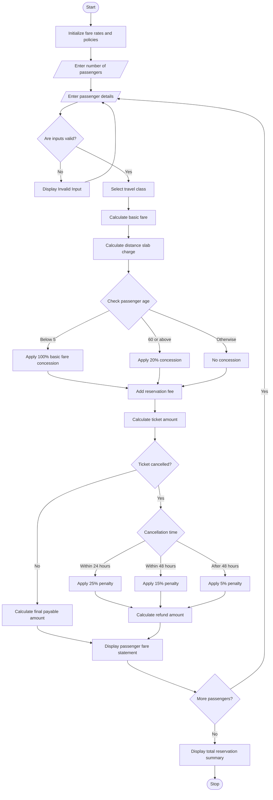

## 1\. Problem Statement

The Railway Fare and Reservation Calculator is designed to calculate railway ticket fares for multiple passengers based on travel distance, travel class, age-based concessions, reservation fees, and cancellation penalties.

The system considers the following factors:

1. **Distance Slabs:** Ticket fares are calculated according to the distance travelled.
2. **Travel Classes:** Different fares are applied for Sleeper, AC 3-Tier, and AC 2-Tier classes.
3. **Age-Based Concessions:**
   - Children below 5 years: Free travel.
   - Senior citizens aged 60 and above: 20% concession.
   - Other passengers: No concession.
4. **Reservation Fees:** An additional reservation fee is charged based on the selected travel class.
5. **Cancellation Penalties:** If a passenger cancels a ticket, a cancellation penalty is deducted from the ticket fare.
6. **Multiple Passengers:** The system calculates individual fares and the total reservation amount.

Finally, the system generates a railway reservation statement displaying passenger details, ticket fares, concessions, reservation fees, cancellation penalties, and final payable amounts.

**Assumed Fare Policy:**

| Travel Class | Fare per KM | Reservation Fee |
| --- | --- | --- |
| Sleeper | ₹1.50 | ₹20 |
| AC 3-Tier | ₹2.50 | ₹40 |
| AC 2-Tier | ₹3.50 | ₹60 |

**Distance Slab Charges:**

| Distance | Additional Charge |
| --- | --- |
| Up to 100 KM | ₹0 |
| 101–300 KM | ₹50 |
| Above 300 KM | ₹100 |

**Cancellation Policy:**

- Cancellation within 24 hours: 25% penalty.
- Cancellation within 48 hours: 15% penalty.
- Cancellation after 48 hours: 5% penalty.

These are illustrative academic rules, not actual railway tariff or cancellation policies.

---

## 2\. Algorithm

1. Start the program.
2. Initialize fare rates for different travel classes.
3. Initialize reservation fees and cancellation penalty rates.
4. Enter the number of passengers.
5. For each passenger, enter:
   - Passenger name.
   - Age.
   - Travel distance.
   - Travel class.
   - Cancellation status.
   - Cancellation time category, if applicable.
6. Validate the passenger details.
7. Calculate the basic fare using the selected travel class.
8. Calculate the additional distance slab charge.
9. Calculate the age-based concession:
   - Below 5 years: 100% concession on basic fare and distance charge.
   - 60 years and above: 20% concession.
   - Others: No concession.
10. Add the reservation fee.
11. Calculate the ticket amount.
12. If the ticket is cancelled, calculate the cancellation penalty.
13. Calculate the final payable or refundable amount.
14. Display the individual passenger fare statement.
15. Calculate and display the total collection and cancellation penalties.
16. Stop the program.

---

## 3\. Flowchart (Mermaid Code)

Copy the following code into the Mermaid Live Editor to generate the flowchart.

[Mermaid Live Editor](<https://mermaid.live/?utm_source=chatgpt.com>

## 4\. Sample Input

text

```text
Enter number of passengers: 4

Enter Passenger Details 1
Enter passenger name: Arun
Enter passenger age: 25
Enter travel distance (KM): 200
Enter travel class (Sleeper/AC 3-Tier/AC 2-Tier): Sleeper
Is ticket cancelled? (yes/no): no

Enter Passenger Details 2
Enter passenger name: Banu
Enter passenger age: 65
Enter travel distance (KM): 300
Enter travel class (Sleeper/AC 3-Tier/AC 2-Tier): AC 3-Tier
Is ticket cancelled? (yes/no): no

Enter Passenger Details 3
Enter passenger name: Charan
Enter passenger age: 35
Enter travel distance (KM): 400
Enter travel class (Sleeper/AC 3-Tier/AC 2-Tier): AC 2-Tier
Is ticket cancelled? (yes/no): yes
Enter hours before departure: 12

Enter Passenger Details 4
Enter passenger name: Divya
Enter passenger age: 4
Enter travel distance (KM): 100
Enter travel class (Sleeper/AC 3-Tier/AC 2-Tier): Sleeper
Is ticket cancelled? (yes/no): no
```

---

## 5\. Sample Output

text

```text
==============================================
       RAILWAY RESERVATION STATEMENT
==============================================

Passenger Number: 1
Passenger Name: Arun
Age: 25
Travel Distance: 200.0 KM
Travel Class: SLEEPER
----------------------------------------------
Basic Fare: Rs. 300.0
Distance Slab Charge: Rs. 50.0
Age Concession: Rs. 0.0
Reservation Fee: Rs. 20
Ticket Amount: Rs. 370.0
Final Payable Amount: Rs. 370.0
Booking Status: Confirmed
----------------------------------------------

Passenger Number: 2
Passenger Name: Banu
Age: 65
Travel Distance: 300.0 KM
Travel Class: AC 3-TIER
----------------------------------------------
Basic Fare: Rs. 750.0
Distance Slab Charge: Rs. 50.0
Age Concession: Rs. 160.0
Reservation Fee: Rs. 40
Ticket Amount: Rs. 680.0
Final Payable Amount: Rs. 680.0
Booking Status: Confirmed
----------------------------------------------

Passenger Number: 3
Passenger Name: Charan
Age: 35
Travel Distance: 400.0 KM
Travel Class: AC 2-TIER
----------------------------------------------
Basic Fare: Rs. 1400.0
Distance Slab Charge: Rs. 100.0
Age Concession: Rs. 0.0
Reservation Fee: Rs. 60
Ticket Amount: Rs. 1560.0
Cancellation Penalty: Rs. 390.0
Refund Amount: Rs. 1170.0
Booking Status: Cancelled
----------------------------------------------

Passenger Number: 4
Passenger Name: Divya
Age: 4
Travel Distance: 100.0 KM
Travel Class: SLEEPER
----------------------------------------------
Basic Fare: Rs. 150.0
Distance Slab Charge: Rs. 0.0
Age Concession: Rs. 150.0
Reservation Fee: Rs. 20
Ticket Amount: Rs. 20.0
Final Payable Amount: Rs. 20.0
Booking Status: Confirmed
----------------------------------------------

==============================================
          RAILWAY BILL SUMMARY
==============================================

Total Passengers: 4
Confirmed Tickets: 3
Cancelled Tickets: 1
Total Ticket Collection: Rs. 1070.0
Total Cancellation Penalty: Rs. 390.0
Total Refund Amount: Rs. 1170.0

==============================================
```

---

## 6\. Result

Thus, the Railway Fare and Reservation Calculator was successfully implemented using Python. The program calculates railway fares for multiple passengers based on distance slabs and travel classes. It applies age-based concessions, adds reservation fees, calculates cancellation penalties, and generates individual passenger fare statements along with a final reservation summary.

**Note:** The fare rates, age concessions, reservation fees, and cancellation policies used in this program are assumed values for academic purposes and do not represent actual Indian Railways rules.In this you have to write the algorithm,flowchart,python source code,sample input,sample output,and the flow chart in mermaid
