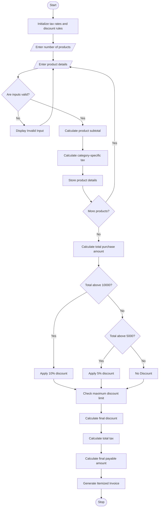

## 1\. Problem Statement

The Retail Billing System is designed to generate an itemized invoice for customers purchasing multiple products from a retail store.

The system calculates the total cost of products based on product prices, quantities, category-specific taxes, and multiple discount rules.

The system considers the following factors:

1. **Product Details:** Enter product name, category, price, and quantity.
2. **Quantity Calculation:** Calculate the total price of each product based on its quantity.
3. **Category-Specific Taxes:** Apply different tax rates depending on the product category.
   - Electronics – 18%.
   - Clothing – 5%.
   - Groceries – 3%.
   - Furniture – 12%.
4. **Threshold Discounts:**
   - Purchase amount above ₹5,000 – 5% discount.
   - Purchase amount above ₹10,000 – 10% discount.
5. **Maximum Concession Limit:** The maximum discount allowed is ₹2,000.
6. **Final Bill Calculation:** Add applicable taxes and subtract the discount to calculate the final payable amount.

Finally, the system generates an itemized invoice showing product details, individual taxes, discounts, total bill, and final payable amount.

## 2\. Algorithm

1. Start the program.
2. Initialize tax rates for different product categories.
3. Initialize discount percentages and maximum concession limit.
4. Enter the number of products.
5. For each product, enter:
   - Product name.
   - Product category.
   - Product price.
   - Product quantity.
6. Validate the product details.
7. Calculate the subtotal for each product.Subtotal = Price × Quantity
8. Calculate the category-specific tax.Tax = Subtotal × Tax Rate / 100
9. Calculate the total purchase amount before discount.Total = Sum of all product subtotals.
10. Apply threshold discounts:
    - Above ₹5,000: 5% discount.
    - Above ₹10,000: 10% discount.
11. Check the maximum concession limit of ₹2,000.
12. Calculate the final discount.
13. Calculate the final payable amount.Final Bill = Subtotal + Total Tax − Discount
14. Generate and display the itemized invoice.
15. Display the total discount and final bill.
16. Stop the program.

## 3\. Flowchart (Mermaid Code)

Copy the following code into the Mermaid Live Editor to generate the flowchart.

[Mermaid Live Editor](<https://mermaid.live/?utm_source=chatgpt.com>

## 4\. Sample Input

text

```text
Enter number of products: 4

Enter Product Details 1
Enter product name: Laptop
Enter category (Electronics/Clothing/Groceries/Furniture): Electronics
Enter product price: Rs. 40000
Enter quantity: 1

Enter Product Details 2
Enter product name: Shirt
Enter category (Electronics/Clothing/Groceries/Furniture): Clothing
Enter product price: Rs. 1000
Enter quantity: 2

Enter Product Details 3
Enter product name: Rice
Enter category (Electronics/Clothing/Groceries/Furniture): Groceries
Enter product price: Rs. 500
Enter quantity: 2

Enter Product Details 4
Enter product name: Chair
Enter category (Electronics/Clothing/Groceries/Furniture): Furniture
Enter product price: Rs. 2000
Enter quantity: 1
```

## 5\. Sample Output

text

```text
==============================================
              RETAIL INVOICE
==============================================

Product        Category       Price     Qty   Subtotal
----------------------------------------------
Laptop         electronics    40000.00  1     40000.00
Shirt          clothing       1000.00   2     2000.00
Rice           groceries      500.00    2     1000.00
Chair          furniture      2000.00   1     2000.00

----------------------------------------------

PRODUCT TAX DETAILS

Laptop - Tax Rate: 18% - Tax Amount: Rs. 7200.0
Shirt - Tax Rate: 5% - Tax Amount: Rs. 100.0
Rice - Tax Rate: 3% - Tax Amount: Rs. 30.0
Chair - Tax Rate: 12% - Tax Amount: Rs. 240.0

==============================================

Total Product Amount: Rs. 45000.0

Total Tax Amount: Rs. 7570.0

Discount Percentage: 10 %

Discount Amount: Rs. 2000.0

----------------------------------------------

FINAL PAYABLE AMOUNT: Rs. 50570.0

==============================================
```

## 6\. Result

Thus, the Retail Billing System was successfully implemented using Python. The program processes multiple products, calculates quantities and category-specific taxes, applies threshold-based discounts, enforces the maximum concession limit, and generates an itemized invoice with the final payable amount.

**Note:** The tax rates, discount percentages, and maximum concession limit used in this program are assumed values for academic purposes. They can be modified according to actual retail business policies.In this you have to write the algorithm,flowchart,python source code, sample input,sample output,and the flow chart in mermaid
