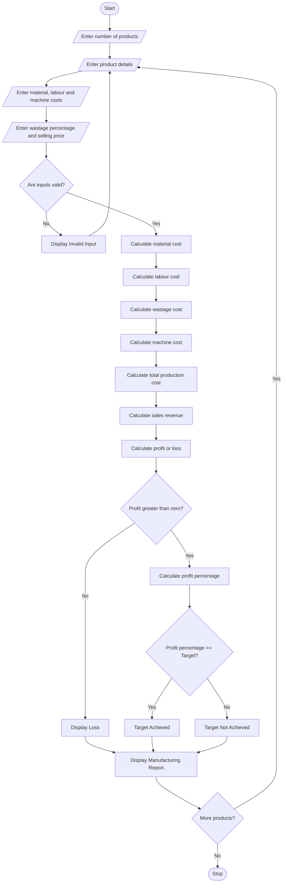

## 1\. Problem Statement

The Manufacturing Cost and Profitability Analysis System is designed to calculate the total production cost and profit of manufactured products by considering material costs, labour charges, wastage, machine costs, and selling prices.

The system evaluates production expenses and determines whether the manufacturing process achieves the specified profit target.

The system considers the following factors:

1. **Material Cost:** Total cost of raw materials used in production.
2. **Labour Charges:** Total wages paid to workers involved in manufacturing.
3. **Wastage Cost:** Additional cost caused by wasted or damaged materials.
4. **Machine Cost:** Expenses related to machine usage and maintenance.
5. **Total Production Cost:** Sum of all manufacturing expenses.
6. **Selling Price:** Price at which the manufactured products are sold.
7. **Profit Calculation:** Difference between total sales revenue and total production cost.
8. **Profit Target:** Determines whether the achieved profit percentage meets the required target.

**Profitability Policy:**

- If profit percentage is equal to or greater than 20%, production is considered profitable.
- If profit percentage is below 20%, production does not meet the target.
- If production cost is greater than selling revenue, the system identifies a loss.

Finally, the system displays the total manufacturing cost, sales revenue, profit or loss, profit percentage, and production status.

## 2\. Algorithm

1. Start the program.
2. Enter the number of products manufactured.
3. Enter the product name.
4. Enter the quantity produced.
5. Enter the raw material cost per unit.
6. Enter the labour cost per unit.
7. Enter the wastage percentage.
8. Enter the machine cost per unit.
9. Enter the selling price per unit.
10. Enter the required profit target percentage.
11. Validate all input values.
12. Calculate the total material cost.

Material Cost = Quantity × Material Cost per Unit

13. Calculate the total labour cost.

Labour Cost = Quantity × Labour Cost per Unit

14. Calculate the wastage cost.

Wastage Cost = Material Cost × Wastage Percentage / 100

15. Calculate the total machine cost.

Machine Cost = Quantity × Machine Cost per Unit

16. Calculate total production cost.

Total Cost = Material Cost + Labour Cost + Wastage Cost + Machine Cost

17. Calculate total sales revenue.

Sales Revenue = Quantity × Selling Price per Unit

18. Calculate profit or loss.

Profit/Loss = Sales Revenue − Total Production Cost

19. Calculate profit percentage.

Profit Percentage = (Profit / Total Production Cost) × 100

20. Compare the profit percentage with the specified target.
21. Display whether production meets the profit target.
22. Display the complete manufacturing cost report.
23. Stop the program.

## 3\. Flowchart (Mermaid Code)

Copy the following code into the Mermaid Live Editor to generate the flowchart.

[Mermaid Live Editor](<https://mermaid.live/?utm_source=chatgpt.com>)


## 4\. Sample Input

text

```text
Enter number of products: 3

Enter Product Details 1
Enter product name: Table
Enter quantity produced: 100
Enter material cost per unit: Rs. 500
Enter labour cost per unit: Rs. 100
Enter wastage percentage: 5
Enter machine cost per unit: Rs. 50
Enter selling price per unit: Rs. 1000
Enter profit target percentage: 20

Enter Product Details 2
Enter product name: Chair
Enter quantity produced: 200
Enter material cost per unit: Rs. 200
Enter labour cost per unit: Rs. 50
Enter wastage percentage: 10
Enter machine cost per unit: Rs. 30
Enter selling price per unit: Rs. 400
Enter profit target percentage: 20

Enter Product Details 3
Enter product name: Cupboard
Enter quantity produced: 50
Enter material cost per unit: Rs. 800
Enter labour cost per unit: Rs. 200
Enter wastage percentage: 8
Enter machine cost per unit: Rs. 100
Enter selling price per unit: Rs. 1200
Enter profit target percentage: 25
```

## 5\. Sample Output

text

```text
==============================================
    MANUFACTURING COST AND PROFIT REPORT
==============================================

Product Number: 1
Product Name: Table
Quantity Produced: 100

----------------------------------------------
Material Cost: Rs. 50000.0
Labour Cost: Rs. 10000.0
Wastage Cost: Rs. 2500.0
Machine Cost: Rs. 5000.0

----------------------------------------------
Total Production Cost: Rs. 67500.0
Total Sales Revenue: Rs. 100000.0
Profit / Loss: Rs. 32500.0
Profit Percentage: 48.15 %
Required Profit Target: 20.0 %
Production Status: Profit Target Achieved

----------------------------------------------

Product Number: 2
Product Name: Chair
Quantity Produced: 200

----------------------------------------------
Material Cost: Rs. 40000.0
Labour Cost: Rs. 10000.0
Wastage Cost: Rs. 4000.0
Machine Cost: Rs. 6000.0

----------------------------------------------
Total Production Cost: Rs. 60000.0
Total Sales Revenue: Rs. 80000.0
Profit / Loss: Rs. 20000.0
Profit Percentage: 33.33 %
Required Profit Target: 20.0 %
Production Status: Profit Target Achieved

----------------------------------------------

Product Number: 3
Product Name: Cupboard
Quantity Produced: 50

----------------------------------------------
Material Cost: Rs. 40000.0
Labour Cost: Rs. 10000.0
Wastage Cost: Rs. 3200.0
Machine Cost: Rs. 5000.0

----------------------------------------------
Total Production Cost: Rs. 58200.0
Total Sales Revenue: Rs. 60000.0
Profit / Loss: Rs. 1800.0
Profit Percentage: 3.09 %
Required Profit Target: 25.0 %
Production Status: Profit Target Not Achieved

----------------------------------------------

==============================================
       OVERALL PRODUCTION SUMMARY
==============================================

Total Products: 3

Total Production Cost: Rs. 185700.0

Total Sales Revenue: Rs. 240000.0

Overall Profit / Loss: Rs. 54300.0

Overall Profit Percentage: 29.24 %

==============================================
```

## 6\. Result

Thus, the Manufacturing Cost and Profitability Analysis System was successfully implemented using Python. The program calculates material costs, labour charges, wastage costs, machine expenses, and selling revenue. It determines the profit or loss, calculates the profit percentage, and identifies whether each product meets the specified profit target.

**Note:** The wastage percentage and profit target used in this program are assumed values for academic purposes. They can be modified according to manufacturing requirements.In this you have to write to algorithm,flowchart,python source code,sample input,sample output,and the flow chart in mermaid
