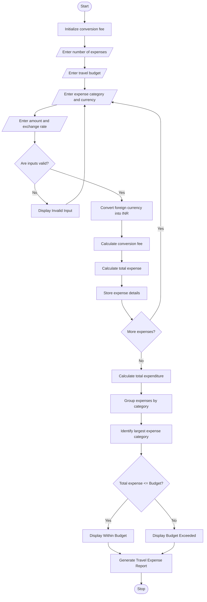

## 1\. Problem Statement

The Multi-Currency Travel Budget Analysis System is designed to calculate and analyze travel expenses incurred in different currencies during international trips.

The system converts expenses from foreign currencies into Indian Rupees (INR) using user-supplied exchange rates. It also includes currency conversion fees, compares total spending against the planned travel budget, and identifies the largest expense category.

The system considers the following factors:

1. **Travel Expenses:** Enter expenses under different categories such as accommodation, food, transportation, and shopping.
2. **Currency Conversion:** Convert foreign currency amounts into INR using the supplied exchange rates.
3. **Conversion Fees:** Apply an additional percentage fee to the converted amount.
4. **Total Expenses:** Calculate the total travel expenditure, including conversion fees.
5. **Budget Comparison:** Compare total expenses with the planned travel budget.
6. **Largest Expense Category:** Identify the category that accounts for the highest expenditure.
7. **Budget Status:** Determine whether the traveler stays within the budget or exceeds it.

**Calculation Rules:**

- Exchange rates are entered manually by the user.
- Conversion fee = 2% of the converted amount.
- All expenses are converted into INR.
- Total expenditure = Converted Amount + Conversion Fee.
- If total expenditure is within the budget, display "Within Budget".
- If total expenditure exceeds the budget, display "Budget Exceeded".

Finally, the system generates a travel expense report showing converted amounts, conversion fees, total expenses, budget status, and the largest expense category.

## 2\. Algorithm

1. Start the program.
2. Initialize the currency conversion fee percentage to 2%.
3. Enter the number of travel expenses.
4. Enter the planned travel budget in INR.
5. For each expense, enter:
   - Expense category.
   - Currency code.
   - Expense amount in foreign currency.
   - Exchange rate against INR.
6. Validate all input values.
7. Convert the foreign currency into INR.Converted Amount = Foreign Amount × Exchange Rate
8. Calculate the conversion fee.Conversion Fee = Converted Amount × 2 / 100
9. Calculate the total expense.Total Expense = Converted Amount + Conversion Fee
10. Store the expense details.
11. Calculate the total travel expenditure.
12. Group expenses according to their categories.
13. Identify the category with the highest total expenditure.
14. Compare total expenditure with the planned budget.
15. If total expenditure is less than or equal to the budget, display "Within Budget".
16. Otherwise, display "Budget Exceeded" and calculate the excess amount.
17. Display the complete travel expense report.
18. Stop the program.

## 3\. Flowchart (Mermaid Code)

Copy the following code into the Mermaid Live Editor to generate the flowchart.

[Mermaid Live Editor](<https://mermaid.live/?utm_source=chatgpt.code


## 4\. Sample Input

text

```text
Enter number of travel expenses: 4

Enter planned travel budget (INR): 60000

Enter Expense Details 1
Enter expense category: Accommodation
Enter currency code (USD/EUR/GBP): USD
Enter expense amount: 300
Enter exchange rate (INR): 83

Enter Expense Details 2
Enter expense category: Food
Enter currency code (USD/EUR/GBP): EUR
Enter expense amount: 150
Enter exchange rate (INR): 90

Enter Expense Details 3
Enter expense category: Transport
Enter currency code (USD/EUR/GBP): USD
Enter expense amount: 100
Enter exchange rate (INR): 83

Enter Expense Details 4
Enter expense category: Shopping
Enter currency code (USD/EUR/GBP): GBP
Enter expense amount: 80
Enter exchange rate (INR): 105
```

## 5\. Sample Output

text

```text
==============================================
       MULTI-CURRENCY TRAVEL BUDGET REPORT
==============================================

Expense Number: 1
Category: Accommodation
Currency: USD
Original Amount: 300.0
Exchange Rate: Rs. 83.0
Converted Amount: Rs. 24900.0
Conversion Fee: Rs. 498.0
Total Expense: Rs. 25398.0

----------------------------------------------

Expense Number: 2
Category: Food
Currency: EUR
Original Amount: 150.0
Exchange Rate: Rs. 90.0
Converted Amount: Rs. 13500.0
Conversion Fee: Rs. 270.0
Total Expense: Rs. 13770.0

----------------------------------------------

Expense Number: 3
Category: Transport
Currency: USD
Original Amount: 100.0
Exchange Rate: Rs. 83.0
Converted Amount: Rs. 8300.0
Conversion Fee: Rs. 166.0
Total Expense: Rs. 8466.0

----------------------------------------------

Expense Number: 4
Category: Shopping
Currency: GBP
Original Amount: 80.0
Exchange Rate: Rs. 105.0
Converted Amount: Rs. 8400.0
Conversion Fee: Rs. 168.0
Total Expense: Rs. 8568.0

----------------------------------------------

CATEGORY-WISE EXPENDITURE

Accommodation : Rs. 25398.0
Food : Rs. 13770.0
Transport : Rs. 8466.0
Shopping : Rs. 8568.0

==============================================
          TRAVEL BUDGET SUMMARY
==============================================

Planned Budget: Rs. 60000.0

Total Converted Amount: Rs. 55100.0

Total Conversion Fees: Rs. 1102.0

Total Travel Expenditure: Rs. 56202.0

----------------------------------------------

Largest Expense Category: Accommodation

Largest Category Amount: Rs. 25398.0

----------------------------------------------

Budget Status: Within Budget

Remaining Budget: Rs. 3798.0

==============================================
```

## 6\. Result

Thus, the Multi-Currency Travel Budget Analysis System was successfully implemented using Python. The program converts travel expenses from different currencies into Indian Rupees using supplied exchange rates, calculates conversion fees, compares total expenditure against the planned budget, and identifies the largest expense category.

**Note:** The exchange rates and 2% conversion fee used in this program are assumed values for academic purposes. Users can enter different exchange rates and modify the conversion fee according to their requirements.In this you have to write the algorithm,flowchart,python source code,sample input,sample output,and the flow chart in mermaid
